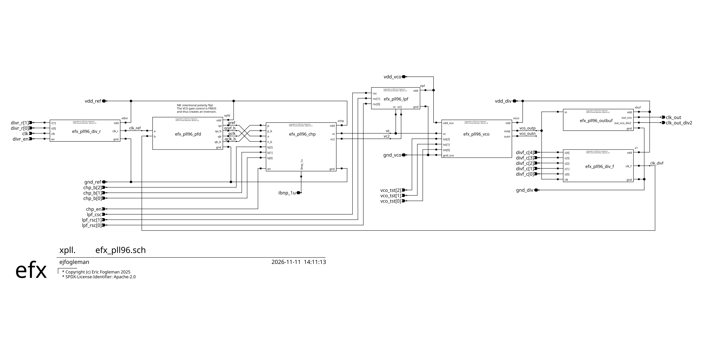

# sky130_efx_ip__pll96 -- 96-100 MHz Analog Integer-N Clock Generation PLL

## Features
* 1.8-V Supply
* 378 uW typical power dissipation
* 4, 6, 8, 12, 16 MHz input clocks for 96 MHz output
* 5, 10 MHz input clocks for 100 MHz output
* Meets USB 1.2 full-speed specification

## Applications
* CPU and digital IP clock generation
* USB clock generation

# IP Overview



efx_pll96 is an analog integer-N charge-pump PLL that multiplies a 4–16 MHz reference clock to 96 MHz (100 MHz from a 5 or 10 MHz reference) and provides a 50% duty-cycle half-rate (48/50 MHz) output for USB full-speed and digital clocking. All divider, loop-filter and charge-pump settings are static digital inputs, so the same block covers every supported reference frequency (see [Programming](#programming)).

The signal path, left to right in the schematic above:

* **Reference divider (`div_r`)** divides the input clock by R = 1, 2 or 4 (`divr_r[1:0]`) and gates it with `divr_en`.
* **Phase-frequency detector (`pfd`)** compares the divided reference with the feedback clock and produces complementary up/down pulses.
* **Charge pump (`chp`)** converts the PFD pulses into current on the control node `vc`. The pump current is set from the bias input and programmed with `chp_b[2:0]`. A replica branch, referenced to the filter's sense-only node `vc2`, keeps the up and down currents matched. `chp_en` disables the pump.
* **Loop filter (`lpf`)** is a second-order passive filter whose capacitors (`lpf_csc`) and resistor (`lpf_rsc[1:0]`) scale with the reference frequency to keep loop bandwidth and damping roughly constant across modes.
* **VCO (`vco`)** is a differential ring oscillator with PMOS control, running from its own `vdd_vco` supply, with a level shifter into the divider domain. Control word `vco_tst[2:0]` forces `vc` to fixed levels for open-loop VCO characterization (normal operation is `000` and disable is `100`).
* **Feedback divider (`div_f`)** is a 5-bit synchronous down-counter clocked by the VCO, dividing by N = 2–32 (`divf_c[4:0]` = N − 1).
* **Output buffer (`outbuf`)** drives `clk_out` at the VCO frequency and `clk_out_div2` at half the VCO frequency.

The reference, VCO and divider circuits use separate supply/ground pairs (`vdd_ref`, `vdd_vco`, `vdd_div`) to limit supply coupling into the oscillator.

# IP Specifications

| Parameter | Min | Typical | Max | Unit | Notes | Comments |
| --- | --- | --- | --- | --- | --- | --- |
| VCO Frequency Range | 86 | 96 | 106 | MHz |  |  |
| Supply Voltage | 1.62 | 1.8 | 1.98 | V |  |  |
| Input frequency range | 4 |  | 16 |  | 4,6,8,12,16 MHz int-N supported |  |
| Operating Temperature | -40 | 25 | 85 | °C |  |  |
| Power Consumption |  | 378 |  | uW | From 1.8 V | 210 uA. Pre-layout sim (tt, 27 °C, C-extracted lvdig cells): 277-312 uW (154-174 uA) for 4-16 MHz input |
| Lock time |  |  | 60 | T_ref | 15 us at 4 MHz, 3.75 us at 16 MHz (60 x R x T_ref if divr divides) |  |
| Jitter (RMS) |  |  | 300 | ps | Meets USB 1.2 full-speed specification | Simulation and analysis |
| Cycle-cycle jitter |  |  | 93 | ps | Meets USB 1.2 full-speed specification | Simulation and analysis |
| Output Duty Cycle | 45 | 50 | 55 | % | 48 MHz output |  |
| Frequency Accuracy | -0.25 | 0 | 0.25 | % | At 25°C |  |
| Output Rise/Fall Time |  |  | 2 | ns | 10-90% of V_max |  |
| Output Load Capacitance |  |  | 100 | fF | Output will be buffered |  |
| Feedback divider value | 2 |  | 32 |  | By 1 (divf_c = N-1).  Int N modes: 24, 16, 12, 8, 6 |  |
| Output divider value | 1 |  | 2 |  | Fixed divider for 48 MHz output | Not programmable |


# IP Pinout

| Pin name | Dir | Use |
| --- | --- | --- |
| vdd_ref | io | ref clock domain supply, 1.8 V+/-10%, 15-35 uA |
| gnd_ref | io | ref clock domain gnd |
| vdd_vco | io | vco domain supply, 1.8 V+/-10%, 100 uA |
| gnd_vco | io | vco domain gnd |
| vdd_div | io | divider domain supply, 1.8 V+/-10%, 75 uA |
| gnd_div | io | divider domain gnd |
| ibnp_1u | io | 1 uA bias current input (from nmos output to pmos diode) |
| clk | i | ref clock input (4--16 MHz) |
| divr_en | i | input divider enable (assert high to enable ref clock) |
| divr_r[1:0] | i | input divide ratio |
| chp_en | i | charge pump enable (assert high to enable chp) |
| chp_b[2:0] | i | charge pump bias |
| lpf_csc | i | filter cap scale |
| lpf_rsc[1:0] | i | filter resistor scale |
| vco_tst[2:0] | i | vco test modes (default low) |
| divf_c[4:0] | i | feedback divider count, N-1 (N = 2--32) |
| clk_out | o | clock output at vco frequency (96 MHz) |
| clk_out_div2 | o | clock output at half vco frequency (48 MHz) |


# Absolute Maximum Ratings

| Parameter | Min | Max | Unit | Notes |
| --- | --- | --- | --- | --- |
| Supply voltage (vdd_ref, vdd_vco, vdd_div) | 1.62 | 1.98 | V | 1.8 V +/-10%, each relative to its own ground |


# Test Ports

These inputs support bring-up and open-loop characterization. In normal operation `chp_en` and `divr_en` are high and `vco_tst[2:0]` is `000`.

| Pin | Normal | Test use |
| --- | --- | --- |
| chp_en | 1 | 0 disables the charge pump, leaving `vc` to the loop filter or to `vco_tst` |
| divr_en | 1 | 0 gates the reference clock off |
| vco_tst[2:0] | 000 | forces the VCO control voltage `vc` to a fixed level (use with `chp_en` = 0); see below |

`vco_tst[2:0]` settings (the VCO control is PMOS, so a lower `vc` gives a higher frequency):

| vco_tst[2:0] | vc |
| --- | --- |
| 000 | normal operation (closed loop) |
| 100 | 1.8 V (VCO disabled) |
| 101 | 0.9 V (3/6 VDD) |
| 001 | 0.771 V (3/7 VDD) |
| 11x | 0.72 V (2/5 VDD) |
| 011 | 0.6 V (2/6 VDD) |
| 010 | 0 V |

With the loop open, stepping `vc` through these levels and measuring `clk_out` gives the VCO tuning curve, and `clk_out_div2` gives the same at half frequency. The fixed levels come from a resistor divider that draws extra current from `vdd_vco` (about 34 uA, test only) while selected. `100` stops the VCO.


# Programming

| F_ref | F_out | N | divr | divf_c[4:0] | lpf_csc | lpf_rsc[1:0] | chp_b[2:0] |
| --- | --- | --- | --- | --- | --- | --- | --- |
| 4M | 96M | 24 | 00 | 10111 | 1 | 00 | 101 |
| 5M | 100M | 20 | 00 | 10011 | 1 | 00 | 101 |
| 5M | 100M | 20 | 00 | 10011 | 1 | 01 | 100 |
| 6M | 96M | 16 | 00 | 01111 | 1 | 01 | 100 |
| 8M | 96M | 12 | 00 | 01011 | 0 | 00 | 101 |
| 10M | 100M | 10 | 00 | 01001 | 0 | 00 | 101 |
| 10M | 100M | 10 | 00 | 01001 | 0 | 01 | 100 |
| 12M | 96M | 8 | 00 | 00111 | 0 | 01 | 100 |
| 16M | 96M | 6 | 00 | 00101 | 0 | 11 | 010 |


# Test Plan

## Equipment needed
Will request access to test resources at UCSD for measurements
* Programmable power supplies for 1.8-V core, 3.3-V IO
* Signal generator for input reference clock
* Spectrum analyzer or phase noise analyzer
* Oscilloscope
* DMM

## Conditions
* Full voltage range at room temp (may not have access to temp chamber)

## To be tested
* Frequency range
* PLL lock time across modes and reference frequencies
* Power consumption
* Jitter, Phase Noise
* Reference spur, other spurious


# Reproducing the Results

Everything here uses open-source tools only; no AI tools are needed to use, verify or modify the design.

**Tools** (versions used):

* xschem 3.4.7 (schematics and netlisting)
* ngspice-43 (simulation)
* magic 8.3.604 and netgen (layout and LVS)
* SkyWater sky130A PDK from open_pdks `54435919abffb937387ec956209f9cf5fd2dfbee`, installed with [ciel](https://github.com/fossi-foundation/ciel) under `~/.ciel` (`PDK_ROOT` and `PDK` default to `~/.ciel` and `sky130A`). The testbenches load the models from `~/.ciel/sky130A/libs.tech/combined/sky130.lib.spice`, corner `tt`.

**Get the sources.** The digital cells come from the [sky130_efx_ip__lvdig](https://github.com/ejfogleman/sky130_efx_ip__lvdig) library, a git submodule:

```bash
git clone --recurse-submodules https://github.com/ejfogleman/sky130_efx_ip__pll96.git
cd sky130_efx_ip__pll96
# in an existing clone: git submodule update --init --recursive
```

**Netlist the testbenches.** Run this first in a new clone: the tracked netlists in `sim/` include the lvdig cell netlist by absolute path, so they must be regenerated for your checkout.

```bash
make sim        # netlists every xschem/tb_*.sch into sim/, with schematic and netlist checks
```

**Simulate.** Run ngspice from `sim/` so `sim/.spiceinit` is read:

```bash
cd sim
./top_reg.sh    # closed-loop locking regression, all reference-frequency modes
ngspice -b -o pfd.out tb_efx_pll96_pfd.spice    # a block-level bench, e.g. the PFD
```

`top_reg.sh` copies each `config_<F>.inc` (one per row of the programming table) to `config.inc`, runs `tb_efx_pll96_top_reg.spice`, and writes `top_reg_<F>.out` and `top_reg_<F>.raw`. Each `.out` ends with a `LOCK pass|fail` line: the run passes when `clk_out` is within 0.25% of the programmed frequency (the Frequency Accuracy spec) and the control voltage `vc` has settled between 0.25 and 0.75 VDD. Each mode simulates about 100 reference periods, longer than the lock time, to show settled behavior. The modes run one after another; a single mode takes from about half an hour (16 MHz) to a few hours (4 MHz) on one thread.

**LVS.**

```bash
make lvs CELL=efx_pll96_dbuf
```
